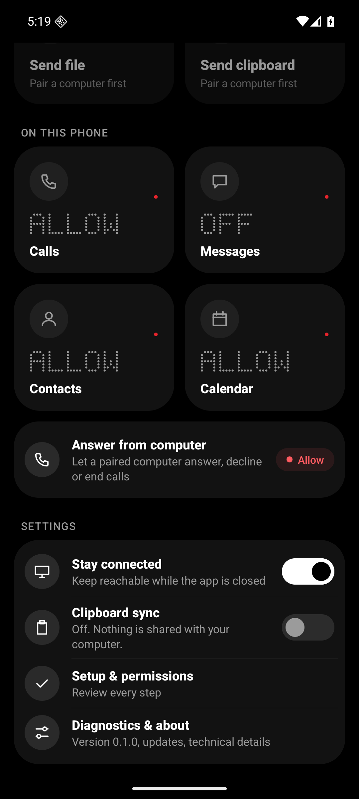
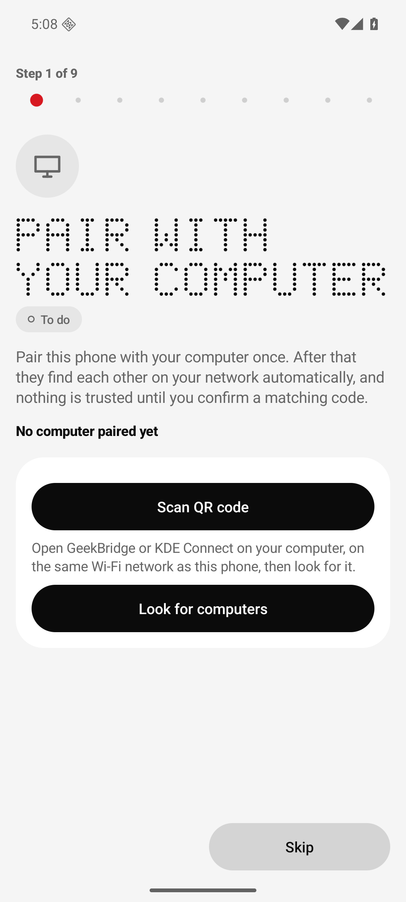
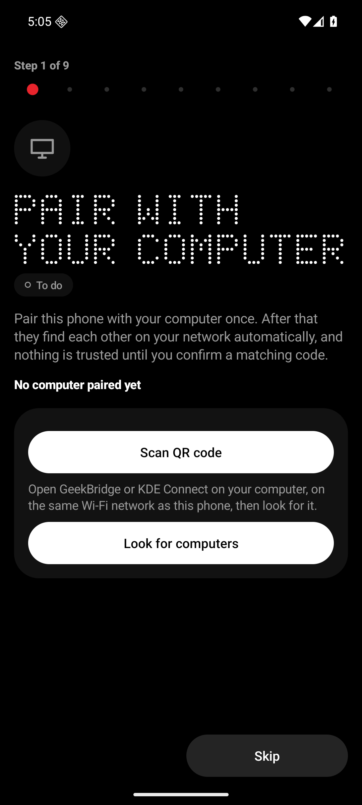
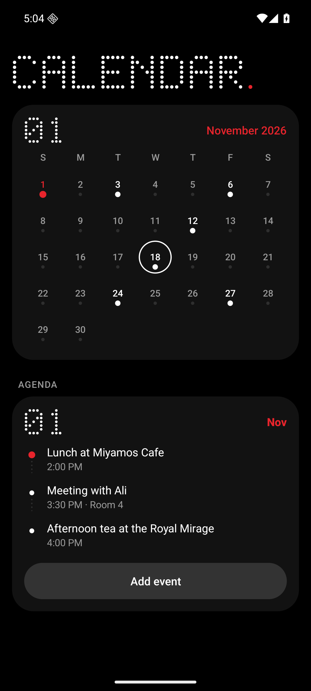
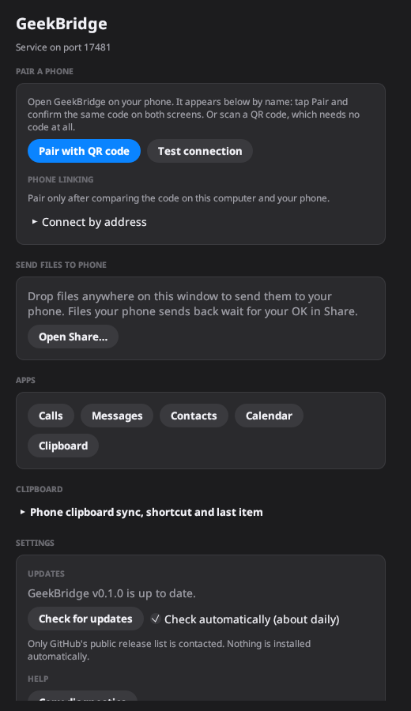
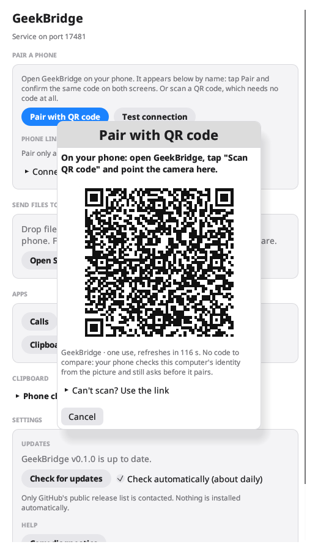
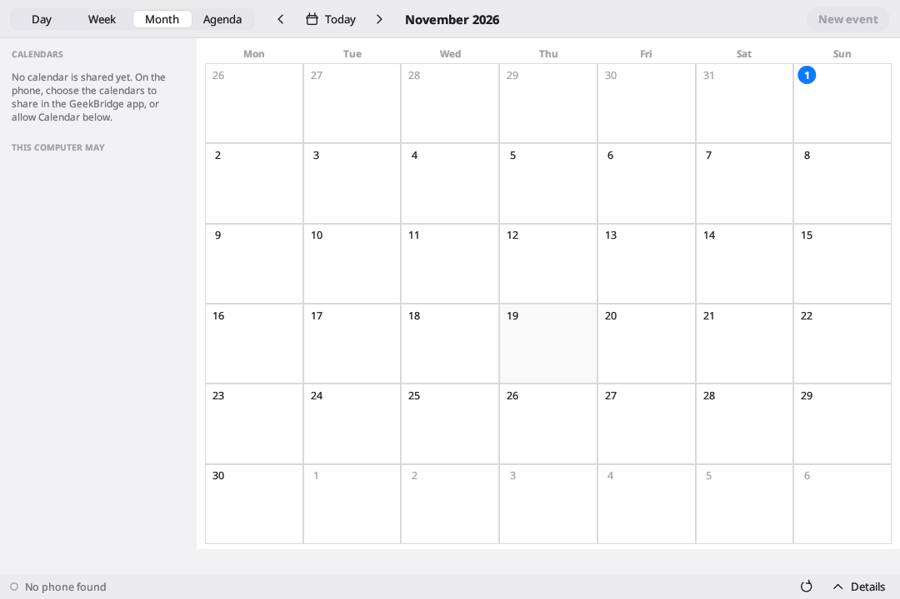
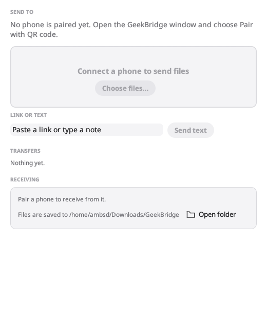

# GeekBridge

**Your Android phone on your computer, without the cloud.** GeekBridge links an Android phone to a Linux, Windows or macOS
computer over your local network: answer calls, read and send SMS, browse contacts and your Google-synced calendar, share
the clipboard, and send files, links and text both ways. Everything is opt-in per phone, pinned by certificate, and stays
on your network. Calls, Messages, Contacts, Calendar, Clipboard and Share are separate native desktop apps (own window,
process and desktop identity) on one small background service, written in Rust, with a Kotlin Android companion on a
shared Rust core. It speaks the KDE Connect transport, and it is styled after Nothing OS: true black, dot-matrix type,
one red accent.

> **Status: 0.1.0. Verified on Linux, an Android emulator and one real phone (a Samsung Galaxy Z Fold5, SM-F946B):
> pairing and the link were exercised on it, and the link-stability fixes came from it. Every other feature below was
> checked only on the emulator or by automated tests.** Windows and macOS have only been built and tested in CI, and there
> are no prebuilt Windows or macOS binaries yet. The feature matrix says exactly what was checked and how.

<p align="center">
  
  
  
  
</p>
<p align="center">
  
  
  
  
</p>

## Feature matrix

"Emulator" means the debug APK on an Android 16 x86_64 emulator talking to the real desktop service
(`scripts/e2e-*.sh`, results in [docs/reports/e2e-findings.md](docs/reports/e2e-findings.md)). "Scripted" means automated tests against
generated peers or a simulated phone/modem on loopback. **Only one physical phone (SM-F946B) has ever been paired, and
only pairing and link behaviour were exercised on it; the Real phone column says "not yet" for every feature that was not
individually confirmed there.**

| Feature | What it does | Verified how | Real phone |
| --- | --- | --- | --- |
| Pairing | QR code or nearby list, code comparison, certificate pinning, unpair on both sides | Emulator (QR, code, unpair); discovery by scripted tests only (emulator NAT drops broadcast) | not yet |
| File, link, text sharing | Both directions, Android Share sheet, drag and drop, up to 8 GiB, SHA-256 checked | Emulator, 500 MB each way | not yet |
| Clipboard | Text, links, HTML, images; computer to phone automatic, phone to computer on demand via hotkey | Scripted + emulator for the transport; hotkey/`wl-clipboard` on Linux | not yet |
| Calls: answer, decline, hang up | Popup and notification on the computer; opt-in on the phone | Emulator (simulated GSM signalling through the link) and a fake `org.pipewire.Telephony` | not yet |
| Call audio on the computer | Bluetooth hands-free (HFP) via PipeWire / WinRT / macOS helper | Simulated signalling only; Bluetooth, SCO and codecs **not verified anywhere** | not yet |
| Messages (SMS) | Conversations, paging, send, notifications; no MMS, group or RCS | Emulator | not yet |
| Contacts | Searchable phonebook, call / message / copy, read-only | Emulator | not yet |
| Calendar | Month, week, day, agenda; Google calendars via the phone's own sync; optional two-way editing | Emulator (provider inserts, desktop create/edit/delete) | not yet |
| Android home-screen widgets | Connection (2x1), Quick actions (2x2), Agenda (4x2) in dot-matrix; light/dark, resizable, no polling | Emulator screenshots, JVM tests for the state/agenda logic | not yet |
| Updates | GitHub release check, SHA-256 verified download, never auto-installs | Emulator self-update against a mock release server; real GitHub not contacted | not yet |
| Phone battery on the computer | Level and charging state in the tray, Home and `status`; **off by default** on both ends | Scripted tests and unit tests against stock `kdeconnect.battery` packets | not yet |
| Dial from the computer | Type a number in Calls (or `geekbridge-ctl call dial`), confirm, the phone places the call; the voice stays on the phone | Scripted tests against a stand-in phone only; nothing was dialed on any network | not yet |
| "Why is it disconnected" | One plain sentence and a fix for each paired phone without a link (Home, tray, waybar, `status`, `doctor`) | Unit and service tests; wording not yet judged on real failures | not yet |
| Android service / battery | Foreground link service, boot restart, OEM battery guidance | Emulator reboot and battery dialog; no OEM device | not yet |

| Desktop | Status |
| --- | --- |
| **Linux** (X11 and Wayland; Hyprland / Omarchy hotkey, window rules, notifications, waybar) | Built, packaged (`.deb`, installer tarball) and run on Arch/Omarchy; the main supported target |
| **Windows** | Built and tested in CI only, installer script written; **never run on a real Windows PC**, unsigned, no prebuilt binary yet |
| **macOS** | Built and tested in CI only, `.dmg` script written; **never run on a Mac**, unsigned, no prebuilt binary yet |
| **Android** | Android 8+ (min SDK 26), arm64-v8a and x86_64; debug and release-signed builds; tested on an emulator, not yet on a physical phone |

**Release builds: Linux and Android only. Windows and macOS: build from source** (releases are built on a Linux
machine, which cannot produce signed or tested Windows/macOS binaries; see [docs/release-local.md](docs/release-local.md)).

## Quick start

1. **Install.** Android: `geekbridge-android.apk` from the latest GitHub release (allow "Install unknown apps"). Linux:
   `sudo apt install ./geekbridge_*.deb`, or extract the installer tarball and run `./install.sh` (per user; the service
   starts at login). Windows and macOS: no prebuilt binaries yet (build from source, below). Check downloads against
   `SHA256SUMS`.
2. **Pair via QR.** Same Wi-Fi. On the computer open **GeekBridge** > **Pair with QR code**. On the phone, in the setup
   wizard choose **Scan QR code**, point the camera at it, tap the link and confirm **Pair**. Or pair by name and compare
   the code on both screens. Then finish the wizard (notifications, contacts, calendar, phone state, **battery**).
3. **Clipboard hotkey.** Switch clipboard sync on for the phone (both sides). Copy on the computer and it reaches the
   phone. To pull the phone's clipboard press **Ctrl+Shift+V** or bind
   `geekbridge-ctl clipboard paste-from-phone --notify` (on Hyprland: `geekbridge-ctl hotkey install --apply`).
4. **Send files.** On the phone: any app > Share > **Send to computer**. On the computer: drop files on the GeekBridge
   window, use **Geekbridge Share**, or `geekbridge-ctl send-file DEVICE FILE`. Receiving is off until you allow it.
5. **Calls.** On the phone switch on **Answer from computer**; allow Calls for the phone on the computer. An incoming
   call shows a popup with Answer / Decline / Hang up in `geekbridge-calls`. To place a call from the computer, type a
   number there (or `geekbridge-ctl call dial +15550100`) and confirm; this needs *Allow placing calls from my
   computer* on the phone. Without a Bluetooth controller in the PC, control still works but the voice stays on the
   phone ([call audio options](docs/call-audio-options.md)).
6. **Contacts and calendar.** Switch **Share contacts** / **Share calendar** on the phone, then open **Contacts** or
   **Calendar** on the computer. Editing the calendar is a separate opt-in.
7. **Updates.** A banner "Update available" appears in every app and on Android; downloads are checksum-verified and never
   installed automatically.
8. **Something wrong?** Run `geekbridge-ctl doctor` (service, firewall, desktop session, phones, Messages, calls; prints the
   fix for each problem and exits 1 if a check failed). A paired phone without a link gets a plain reason and a
   suggested fix in Home, the tray, `geekbridge-ctl status` and waybar.

**Android build types.** The GitHub release APK is signed with the release key. A debug APK (what `scripts/build-android.sh`
makes) is signed with a local debug key: it works for testing, but it can never update to a release build or the other way
round; uninstall one before installing the other.

**Uninstall (Linux).** `./install.sh --uninstall` removes the program and keeps your pairings and settings;
`./install.sh --uninstall --purge-data` also deletes them (`~/.local/state/geekbridge`).

## Requirements

- **Android 8.0 or newer** (API 26).
- **Same local network** for phone and computer (no guest-Wi-Fi client isolation, no full-tunnel VPN).
- **Firewall: allow TCP and UDP 1716-1764** from your LAN to the computer (`geekbridge-ctl firewall` prints the commands;
  `geekbridge-ctl doctor` checks them, the desktop session, your phones and Messages, and says what to fix). The first free port in that range is used; file
  transfers use further ports in it. The control API itself stays on loopback (17380, 17381).
- **Bluetooth:** answering, declining and hanging up from the computer work over the GeekBridge link and need **no**
  Bluetooth. Hearing and speaking on the computer needs the computer to be the phone's Bluetooth hands-free device, so a
  **Bluetooth controller on the PC** (many desktops have none; a USB adapter works) and an HFP-capable audio stack.
- Linux clipboard: `wl-clipboard` (Wayland, needs the data-control protocol: Hyprland, Sway, KDE; not stock GNOME) or
  `xclip` (X11). Rust 1.88+ and eframe's graphics libraries to build from source.

## Documentation

Full index: [docs/README.md](docs/README.md).

- [User guide](docs/user-guide.md), with symptom-keyed troubleshooting
- [Omarchy / Hyprland setup](docs/omarchy.md) (also GNOME, KDE, sway)
- [Real-device quickstart](docs/real-device-quickstart.md) and [full test plan](docs/real-device-test-plan.md)
- [Pairing](docs/pairing.md), [sharing](docs/sharing.md), [clipboard](docs/clipboard-sync.md),
  [call control](docs/call-control.md), [phone data (contacts, calendar, SMS)](docs/phone-data-link.md),
  [updates](docs/updates.md), [Android power and battery](docs/android-power.md)
- Security: [SECURITY.md](SECURITY.md), [security review](docs/reports/security-review.md),
  [second security review](docs/reports/security-review-2.md)
- [CHANGELOG](CHANGELOG.md), [release checklist](docs/release-checklist.md), [architecture](docs/architecture.md),
  [builds](docs/builds.md), [e2e findings](docs/reports/e2e-findings.md), [performance](docs/performance.md)

## Build from source

Fresh clone, Linux / macOS / Windows with WSL2:

```sh
git clone https://github.com/fspecii/geekbridge && cd geekbridge
scripts/dev-setup.sh          # checks Rust >= 1.88, JDK 17, Android SDK, system libraries; installs nothing (add --install to fix gaps)
make check                    # cargo fmt --check, clippy -D warnings, all Rust tests
make android                  # Android unit tests + lint (./gradlew with your JDK 17 and ANDROID_HOME)
make desktop                  # build and start the service and the Home window
make help                     # all targets (perf, docs-links, ...)
```

The same steps without make:

```sh
cargo build --workspace                 # whole Rust workspace
scripts/build-desktop.sh                # release binaries into dist/linux/
(cd android && ./gradlew :app:testDebugUnitTest :app:lintDebug)   # Android JVM tests and lint; the Gradle wrapper is checksum-pinned
scripts/bootstrap-android.sh            # optional, Linux x86_64: project-local JDK, Gradle, SDK, NDK, Rust Android targets in .tools/
scripts/build-android.sh                # with that toolchain: native libs, unit tests, lint, debug APK -> dist/android/geekbridge-debug.apk
source scripts/android-env.sh           # put the project-local toolchain on PATH for gradle / adb in this shell
```

Nothing is installed globally. Details, pinned versions and release flow: [docs/builds.md](docs/builds.md). Run the
desktop from source with `scripts/run-desktop.sh` or:

```sh
cargo run -p bridge-service --bin geekbridge-service      # in one terminal
cargo run -p bridge-apps --bin geekbridge                 # Home window; also geekbridge-calls, -messages, -contacts,
                                                          # -agenda (the Calendar app), -clipboard, -share
```

Every app supports `--help`, `--api-port PORT` and `--theme light|dark|system`; the helper apps (not Home) also take
`--status`, and `geekbridge-ctl --state-dir DIR status` reports the service. Service options include
`--api-port`, `--control-port`, `--state-dir`, `--discovery-port`, `--no-listen-inbound`, `--no-announce`. If KDE Connect
or GSConnect already owns UDP 1716, GeekBridge reports the conflict instead of taking over.

Validation:

```sh
cargo fmt --all -- --check
cargo clippy --workspace --all-targets --locked -- -D warnings
cargo test --workspace --locked
scripts/perf-check.sh --build     # idle service budget
scripts/build-android.sh          # Android tests, lint, debug APK
scripts/e2e-android.sh            # emulator end to end (see docs/reports/e2e-findings.md)
```

Calls can be exercised without a phone or Bluetooth: `scripts/emulate-call.sh fake` drives the real call state machine
against a fake `org.pipewire.Telephony` service ([docs/emulated-calls.md](docs/emulated-calls.md)). Developer transport
tools (`geekbridge-pair`, `geekbridge-call-probe`) are described in [docs/call-control.md](docs/call-control.md) and
[docs/kdeconnect-interop.md](docs/kdeconnect-interop.md).

## Privacy and security in one paragraph

Pairing pins both TLS certificates; discovery never grants trust; contacts, calendar, SMS, battery level, phone notifications (only from apps you pick), clipboard,
calls (including dialing) and file receiving are each off until you allow them for a specific phone on both sides, and
nothing from the phone is stored on the computer (battery level and mirrored notifications are held in memory only). The only internet traffic is
the optional update check to GitHub; there are no accounts and no GeekBridge servers. Report vulnerabilities privately as
described in [SECURITY.md](SECURITY.md).

## Documentation

[Architecture and roadmap](docs/architecture.md), the [user guide](docs/user-guide.md), the
[KDE Connect interoperability notes](docs/kdeconnect-interop.md) and the [release checklist](docs/release-checklist.md).
GeekBridge is an independent implementation of the KDE Connect protocol: it contains no KDE Connect code and is not
affiliated with or endorsed by the KDE project.

## Contributing

See [CONTRIBUTING.md](CONTRIBUTING.md) (DCO sign-off, build and test commands) and the
[Code of Conduct](CODE_OF_CONDUCT.md). Report security problems privately as described in [SECURITY.md](SECURITY.md).

## Licence

GeekBridge is free software, licensed under the **GNU General Public License, version 3 or (at your option) any later
version** (`GPL-3.0-or-later`). The full text is in [LICENSE](LICENSE). Contributions are accepted under the same
licence. Third-party components keep their own licences: see [THIRD_PARTY_NOTICES.md](THIRD_PARTY_NOTICES.md) and
[third_party/fonts](third_party/fonts/README.md). Source code: <https://github.com/fspecii/geekbridge>.
