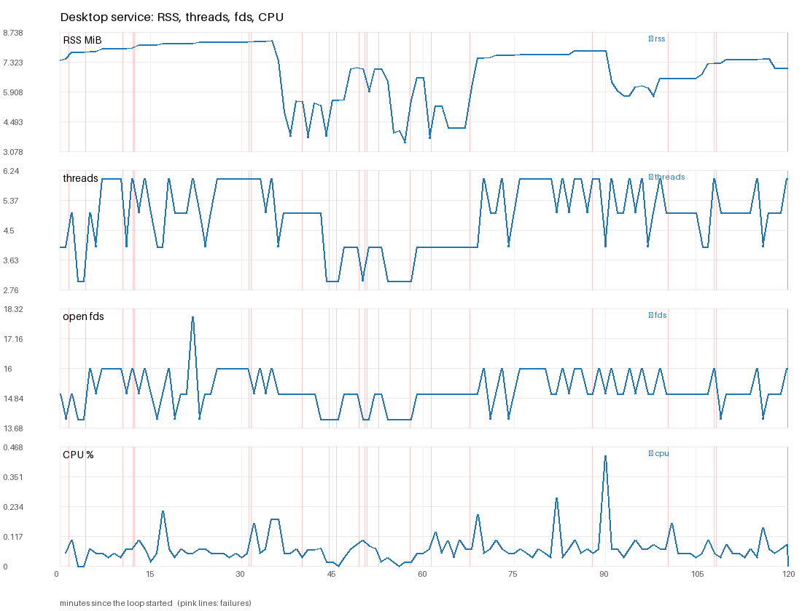
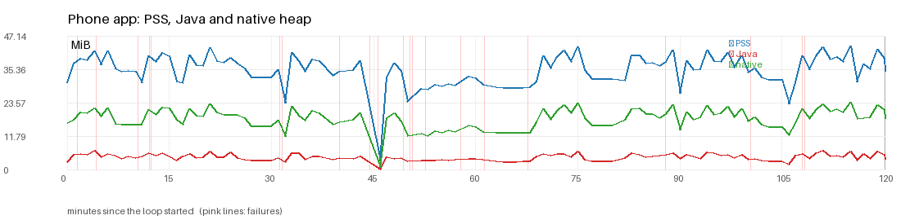
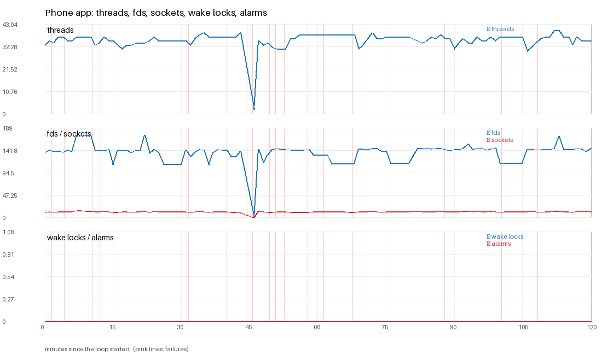
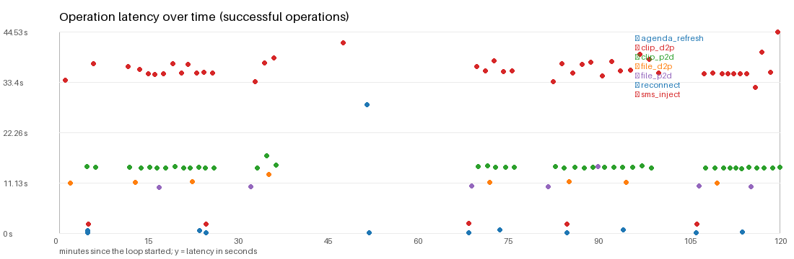

# Stability soak report

> Status: snapshot from 2026-11-02, see git history for later changes. Numbers and findings below describe that point in time, not necessarily the current tree.

Run `full1`: loop length 120 min, 122 samples every ~60 s. Release (R8) APK on an x86_64 emulator, release desktop service, `scripts/soak-e2e.sh`. Emulator numbers are a regression baseline, not phone numbers.

**Scope.** One 120-minute loop (run `full1`, 2026-11-02) on release builds: `geekbridge-service` (`cargo build --release --locked -p bridge-service -p bridge-apps`) and the R8 release APK, on an x86_64 emulator (AVD `gb36s`, own adb server and ports, own desktop state, scratch `HOME`, private Xvfb; nothing of the user's real `~/.config` or Downloads was touched). Driven by `scripts/soak-e2e.sh` (`DURATION=7200`): a clipboard round trip each way every 60 s, a 5-20 MB file alternating direction with SHA-256 check every 5 min, a link flap every 10 min (clean `ctl disconnect` alternating with a 25 s guest black hole), an incoming call answered and hung up, a contacts/calendar refresh and an SMS injection every 20 min, a force-stop every 30 min, 5-minute screen-off gaps. Samples every 60 s. Raw data: `dist/soak/full1/` (`samples.csv`, `events.tsv`, `failures.log`, logs).

**Headline.** No resource leak in 2 hours: the desktop service and the phone app stay flat on memory, threads, descriptors, sockets, wake locks and alarms (tables below). The soak did find and fix two real app defects (call answer and clipboard sync after a process kill, below) and several harness problems. The failures listed under "Failures" are from this run, before those fixes; the confirmation runs at the end are clean.

> Wake locks and alarms are read from `dumpsys power` / `dumpsys alarm` for the app's uid; both were 0 in all 122 samples. Phone PSS in the idle-budget table is above the 35 MB *idle, app closed* budget (late median 36.0 MiB, peak 43.7 MiB) because the soak keeps the app open and busy; compare it with the budget only as a ceiling check. The minimum rows (3 MiB, 2 threads) are samples taken right after a deliberate force-stop.

## Charts









## Resource trends (leak check)

Growth = median of the last quarter minus the median of the first quarter of the samples after the first 10 % (warm-up). A series is flagged **GROWTH** when it grew by more than its absolute floor and more than 5 %, with a positive least-squares slope.

| series | start | end | min | max | early median | late median | growth | slope /h | verdict |
|---|---|---|---|---|---|---|---|---|---|
| Desktop RSS | 7.4MiB | 7.0MiB | 3.5MiB | 8.3MiB | 8.2MiB | 7.0MiB | -1.2MiB | -0.21MiB | flat |
| Desktop threads | 4.0 | 6.0 | 3.0 | 6.0 | 5.0 | 5.0 | 0.0 | 0.22 | flat |
| Desktop open fds | 15.0 | 16.0 | 14.0 | 18.0 | 15.0 | 15.0 | 0.0 | 0.07 | flat |
| Desktop CPU | 0.1% | 0.0% | 0.0% | 0.4% | 0.1% | 0.1% | 0.0% | 0.00% | flat |
| Phone PSS (total) | 30.6MiB | 34.7MiB | 3.0MiB | 43.7MiB | 37.5MiB | 36.0MiB | -1.4MiB | 1.28MiB | flat |
| Phone Java heap | 2.6MiB | 3.6MiB | 0.2MiB | 6.7MiB | 4.5MiB | 4.3MiB | -0.2MiB | 0.28MiB | flat |
| Phone native heap | 16.5MiB | 17.9MiB | 0.7MiB | 23.7MiB | 19.2MiB | 18.5MiB | -0.7MiB | 1.07MiB | flat |
| Phone threads | 33.0 | 35.0 | 2.0 | 40.0 | 35.0 | 37.0 | 2.0 | 0.96 | flat |
| Phone open fds | 138.0 | 146.0 | 0.0 | 173.0 | 139.5 | 144.0 | 4.5 | 5.92 | flat |
| Phone sockets | 11.0 | 12.0 | 0.0 | 13.0 | 12.0 | 12.0 | 0.0 | 0.43 | flat |
| Phone wake locks held | 0.0 | 0.0 | 0.0 | 0.0 | 0.0 | 0.0 | 0.0 | 0.00 | flat |
| Phone alarms | 0.0 | 0.0 | 0.0 | 0.0 | 0.0 | 0.0 | 0.0 | 0.00 | flat |

```
Desktop RSS              ▆▇▇▇▇▇▇▇▇▇▇▇▇▇▇▇▇█▄▂▂▃▂▃▆▅▅▃▁▄▃▃▁▁▅▆▆▆▆▆▆▇▇▇▇▆▄▄▄▄▅▅▅▅▆▆▆▆▆▆▆
Desktop threads          ▃▃▃▅█▅▆▆▃▆▅▆▄████▆▄▅▅▅▁▂▃▂▃▁▁▂▃▃▃▃▃▆▆▄███▆▆▆█▅▅▆▅▆▅▅▅▃▆▅▅▆▄▅█
Desktop open fds         ▂▂▄▆█▆▆▆▂▄▄█▄███▆▆▄▄▄▂▁▂▄▁▄▁▁▂▄▄▄▄▄▄▆▂██▆▆▆▆▆▆▄▆▆▆▄▄▄▄▄▄▄▆▂▄█
Desktop CPU              ▃▁▂▂▂▂▃▁▄▂▂▂▂▂▂▄▂▆▂▂▂▂▁▂▃▃▁▁▁▂▃▃▂▂▄▃▂▂▂▂▅▂▃▂█▂▂▃▃▂▄▂▂▃▂▂▂▃▂▃▁
Phone PSS (total)        ▅▆▇▇▇▆▇▆▆▆▆▅▇▇▇▇▅▅▇▆▆▇▇▇▇▆▆▆▆▆▆▆▄▇▇▆▇▇▆▆▆▇▁▆▆▆▄▅▅▅▅▅▅▆▆▅▅▅▅▅▅▅▅▇▆▇▇▇▇▆▆▆▆▆▅▇▇▆▆▆▇▇▅▇▆▆▇▇▇▇▆▇▆▆▆▅▅▅▄▅▇▆▇▇▇▇▇█▅▆▆▇▇▆
Phone Java heap          ▃▆▆▆▇▅▆▆▅▅▅▆▆▆▇▆▄▅▆▅▅▇▅▅▇▅▄▄▄▄▄▅▃▇▆▄▅▅▄▅▅▆▁▅▅▅▃▄▄▄▄▄▄▅▅▄▃▃▃▃▃▃▆▆▆▆▆▅▇▄▄▄▄▄▅▇▆▅▅▆▆▇▅▆▅▅▇▆▆▆▅▆▄▄▄▄▄▄▂▆▆▅▇█▆▆▅▇▄▆▄▇▆▄
Phone native heap        ▅▆▆▆▇▆▇▅▅▅▅▅▇▆▇▇▆▅▇▆▆▇▆▆▆▆▆▅▅▅▅▆▄▇▆▆▇▆▅▅▆▆▁▆▆▅▄▄▄▄▄▅▄▅▅▄▄▄▄▄▄▄▅▇▆▇▇▆▇▆▅▅▅▅▆▇▇▆▆▆▆▇▄▆▆▆▇▆▆▇▆▇▆▆▅▅▅▅▄▅▇▆▇▇▇▇▆█▆▆▆▇▇▆
Phone threads            ▆▇▆▇▇▇▇▇▇▇▇▆▆▇▇▇▆▆▆▆▆▆▆▇▇▇▇▇▇▇▇▇▆▇▇▇▇▇▇▇▇▇▇▇▁▇▆▆▆▆▆▆▇▇▇▇▇▇▇▇▇▇▇▇▇▇▇▆▆▇▇▇▇▇▇▇▇▇▇▇▆▇▇▇▇▇▇▆▆▇▆▆▇▇▇▇▇▇▇▇▇▇▇▆▆▆▇▇▇██▇▇▆▇▇▇▇▇
Phone open fds           ▆▆▆▆▆▆▆▇█▇▇▆▆▆▆▅▆▆▆▆▆▆▇▆▆▆▅▅▅▅▅▆▆▆▆▆▅▆▆▆▆▆▆▆▁▆▅▆▆▆▆▆▆▆▆▆▆▆▆▆▆▅▅▅▅▅▅▆▆▆▆▆▆▆▅▅▅▅▅▆▆▆▆▆▆▆▆▆▆▆▇▆▆▆▆▆▆▅▅▅▅▅▅▆▆▆▆▆▆▆▇▆▆▆▆▆▆▆▆
Phone sockets            ▆▇▆▇▇▇▇██▇▇▇▇▇▇▆▆▇▇▆▇▇▇▆▇▇▇▇▇▇▇▇▆▇▇▇▆▇▇▇▇▆▆▆▁▇▇▆▆▇▇▇▆▆▆▆▆▇▇▇▇▇▇▇▇▆▆▇▇▇▇▇▆▇▇▇▇▇▇▇▇▇▇▇▇▇▇▇▇▇▇▇▇▇▇▇▇▆▇▇▇▇▇▇▇▇▆▇▇▇▇▇▇▆▇▇▇▇▇
Phone wake locks held    ▁▁▁▁▁▁▁▁▁▁▁▁▁▁▁▁▁▁▁▁▁▁▁▁▁▁▁▁▁▁▁▁▁▁▁▁▁▁▁▁▁▁▁▁▁▁▁▁▁▁▁▁▁▁▁▁▁▁▁▁▁
Phone alarms             ▁▁▁▁▁▁▁▁▁▁▁▁▁▁▁▁▁▁▁▁▁▁▁▁▁▁▁▁▁▁▁▁▁▁▁▁▁▁▁▁▁▁▁▁▁▁▁▁▁▁▁▁▁▁▁▁▁▁▁▁▁
```

**Leak verdict:** no series grew past its floor in the measured window.

## Against the documented budgets

| series | budget | peak in the soak | late median | verdict |
|---|---|---|---|---|
| Desktop RSS | 10.0MiB (idle 10 000 kB) | 8.3MiB | 7.0MiB | within |
| Desktop threads | 8 (idle budget) | 6.0 | 5.0 | within |
| Desktop open fds | 20 (idle budget) | 18.0 | 15.0 | within |
| Phone PSS (total) | 35.0MiB (idle, app closed) | 43.7MiB | 36.0MiB | **over** (late median) |
| Phone threads | 32 (idle, app closed) | 40.0 | 37.0 | **over** (late median) |
| Phone wake locks held | 0 (idle) | 0.0 | 0.0 | within |
| Phone alarms | 0 (idle) | 0.0 | 0.0 | within |

## Operations

| operation | runs | ok | success | p50 | p95 | max |
|---|---|---|---|---|---|---|
| agenda_refresh | 6 | 6 | 100 % | 0.0 s | 0.1 s | 0.1 s |
| app_restart | 4 | 4 | 100 % | 11.5 s | 36.6 s | 36.6 s |
| blackhole_recover | 5 | 5 | 100 % | 0.0 s | 0.0 s | 0.0 s |
| call_answer | 5 | 0 | 0 % | - | - | - |
| call_hangup | 5 | 1 | 20 % | 0.0 s | 0.0 s | 0.0 s |
| call_ring | 6 | 5 | 83 % | 1.0 s | 5.0 s | 5.0 s |
| clip | 2 | 0 | 0 % | - | - | - |
| clip_d2p | 46 | 45 | 98 % | 35.7 s | 39.9 s | 44.5 s |
| clip_p2d | 46 | 43 | 93 % | 14.5 s | 14.9 s | 17.1 s |
| file | 1 | 0 | 0 % | - | - | - |
| file_d2p | 9 | 8 | 89 % | 11.3 s | 13.0 s | 13.0 s |
| file_p2d | 9 | 7 | 78 % | 10.3 s | 14.8 s | 14.8 s |
| flap_close | 6 | 6 | 100 % | 0.0 s | 0.0 s | 0.0 s |
| idle_screen_off | 4 | 4 | 100 % | 303.5 s | 303.9 s | 303.9 s |
| peer_gone_detect | 4 | 4 | 100 % | 1.2 s | 9.4 s | 9.4 s |
| reconnect | 6 | 6 | 100 % | 0.6 s | 28.3 s | 28.3 s |
| recover | 3 | 3 | 100 % | 11.6 s | 38.2 s | 38.2 s |
| sms_inject | 6 | 5 | 83 % | 2.0 s | 2.1 s | 2.1 s |

**Link uptime:** 78.7 % of 122 samples saw a connected link (this includes the deliberate flaps, call/restart gaps and the screen-off periods).

**Wake locks:** max 0 held by the app at any sample; 0 of 122 samples saw one.

**Log error counts at the end** (desktop ERROR/WARN lines: 0/0, phone logcat W+ lines matching error patterns: 335).

## Failures

| t+ min | operation | detail |
|---|---|---|
| 1.5 | clip_p2d | soak-p2d-1-3650 |
| 4.3 | clip_d2p | soak-d2p-2-15199 |
| 10.4 | file_p2d | 20MB |
| 12.1 | call_answer | modem off-hook |
| 12.3 | call_hangup | modem idle |
| 31.2 | call_answer | modem off-hook |
| 31.6 | call_hangup | modem idle |
| 40.0 | clip | task exceeded the 200s watchdog |
| 44.4 | file_p2d | 18MB |
| 45.7 | file | task exceeded the 330s watchdog |
| 49.4 | clip_p2d | soak-p2d-19-24054 |
| 50.4 | call_answer | modem off-hook |
| 50.7 | call_hangup | modem idle |
| 52.6 | sms_inject | soaksms39429 |
| 57.8 | file_d2p | 6MB accepted=0 size=0 |
| 61.3 | clip | task exceeded the 200s watchdog |
| 67.7 | call_answer | modem off-hook |
| 87.9 | call_ring | desktop never saw it ringing |
| 100.3 | clip_p2d | soak-p2d-37-24521 |
| 108.0 | call_answer | modem off-hook |
| 108.3 | call_hangup | modem idle |

Logs recorded with each failure (`failures.log`, truncated to 12 000 characters):

```
=== t+89s 03:59:48 clip_p2d: desktop clipboard is 'stale', wanted soak-p2d-1-3650; pull said: The phone's clipboard is empty.
error: The phone's clipboard is empty.
--- desktop service log (last 25 lines)
GeekBridge service: discovery API 127.0.0.1:17880 (read-only), control API 127.0.0.1:17881 (authenticated)
--- phone logcat, app lines (last 25)
11-02 03:58:40.204  1082  1093 W TelephonyPermissions: reportAccessDeniedToReadIdentifiers:dev.geekbridge.android:getActiveSubscriptionInfoList:1
11-02 03:59:23.463  1082  1221 W TelephonyPermissions: reportAccessDeniedToReadIdentifiers:dev.geekbridge.android:getActiveSubscriptionInfoList:1
11-02 03:59:29.458   695   805 W InputDispatcher: Waiting because no window has focus but ActivityRecord{11389630 u0 dev.geekbridge.android/.HomeActivity t43} may eventually add a window when it finishes starting up. Will wait for 5000ms
11-02 03:59:46.088   695  1748 W NotificationService: Toast already killed. pkg=dev.geekbridge.android token=android.os.BinderProxy@f5d8c8f
--- link: [('connected', '')]

=== t+262s 04:02:41 clip_d2p: phone clipboard never showed soak-d2p-2-15199
--- desktop service log (last 25 lines)
GeekBridge service: discovery API 127.0.0.1:17880 (read-only), control API 127.0.0.1:17881 (authenticated)
--- phone logcat, app lines (last 25)
11-02 03:58:40.204  1082  1093 W TelephonyPermissions: reportAccessDeniedToReadIdentifiers:dev.geekbridge.android:getActiveSubscriptionInfoList:1
11-02 03:59:23.463  1082  1221 W TelephonyPermissions: reportAccessDeniedToReadIdentifiers:dev.geekbridge.android:getActiveSubscriptionInfoList:1
11-02 03:59:29.458   695   805 W InputDispatcher: Waiting because no window has focus but ActivityRecord{11389630 u0 dev.geekbridge.android/.HomeActivity t43} may eventually add a window when it finishes starting up. Will wait for 5000ms
11-02 03:59:46.088   695  1748 W NotificationService: Toast already killed. pkg=dev.geekbridge.android token=android.os.BinderProxy@f5d8c8f
11-02 04:00:06.405  1569  1582 W MediaProvider: Ignoring mutation of date_expires from dev.geekbridge.android
--- link: [('connected', '')]

=== t+627s 04:08:46 file_p2d: soak-2-20mb: not received/sha mismatch (transfer: #2 <- sdk_gphone64_x86_64 Failed 0/20971528 bytes soak-2-20mb.png (tls_failed))
--- desktop service log (last 25 lines)
GeekBridge service: discovery API 127.0.0.1:17880 (read-only), control API 127.0.0.1:17881 (authenticated)
--- phone logcat, app lines (last 25)
11-02 03:58:40.204  1082  1093 W TelephonyPermissions: reportAccessDeniedToReadIdentifiers:dev.geekbridge.android:getActiveSubscriptionInfoList:1
11-02 03:59:23.463  1082  1221 W TelephonyPermissions: reportAccessDeniedToReadIdentifiers:dev.geekbridge.android:getActiveSubscriptionInfoList:1
11-02 03:59:29.458   695   805 W InputDispatcher: Waiting because no window has focus but ActivityRecord{11389630 u0 dev.geekbridge.android/.HomeActivity t43} may eventually add a window when it finishes starting up. Will wait for 5000ms
11-02 03:59:46.088   695  1748 W NotificationService: Toast already killed. pkg=dev.geekbridge.android token=android.os.BinderProxy@f5d8c8f
11-02 04:00:06.405  1569  1582 W MediaProvider: Ignoring mutation of date_expires from dev.geekbridge.android
11-02 04:02:40.146  1082  1258 W TelephonyPermissions: reportAccessDeniedToReadIdentifiers:dev.geekbridge.android:getActiveSubscriptionInfoList:1
11-02 04:02:40.180   695   726 W ProcessStats: Tracking association SourceState{b65c831 dev.geekbridge.android/10226 BTop #2674} whose proc state 2 is better than process ProcessState{43b5b16 android.process.acore/10096 pkg=com.android.providers.contacts (sub)} proc state 15 (1 skipped)
11-02 04:03:02.637  1082  1369 W TelephonyPermissions: reportAccessDeniedToReadIdentifiers:dev.geekbridge.android:getActiveSubscriptionInfoList:1
11-02 04:03:07.735  1082  1258 W TelephonyPermissions: reportAccessDeniedToReadIdentifiers:dev.geekbridge.android:getActiveSubscriptionInfoList:1
11-02 04:04:10.477  1082  1258 W TelephonyPermissions: reportAccessDeniedToReadIdentifiers:dev.geekbridge.android:getActiveSubscriptionInfoList:1
--- link: [('connected', '')]

=== t+724s 04:10:23 call_answer: answer did not take the modem off-hook (state 1); ctl said: ok; calls: ringing | number: - | name: - | answer: phone-link reject: phone-link hangup: -|audio: NoCall|notice: The call had already changed on the phone.|source: Phone link (sdk_gphone64_x86_64): ready.|source: Bluetooth hands-free calling is not available on this computer.|source: Call audio on this compute
--- desktop service log (last 25 lines)
GeekBridge service: discovery API 127.0.0.1:17880 (read-only), control API 127.0.0.1:17881 (authenticated)
--- phone logcat, app lines (last 25)
11-02 03:58:40.204  1082  1093 W TelephonyPermissions: reportAccessDeniedToReadIdentifiers:dev.geekbridge.android:getActiveSubscriptionInfoList:1
11-02 03:59:23.463  1082  1221 W TelephonyPermissions: reportAccessDeniedToReadIdentifiers:dev.geekbridge.android:getActiveSubscriptionInfoList:1
11-02 03:59:29.458   695   805 W InputDispatcher: Waiting because no window has focus but ActivityRecord{11389630 u0 dev.geekbridge.android/.HomeActivity t43} may eventually add a window when it finishes starting up. Will wait for 5000ms
11-02 03:59:46.088   695  1748 W NotificationService: Toast already killed. pkg=dev.geekbridge.android token=android.os.BinderProxy@f5d8c8f
11-02 04:00:06.405  1569  1582 W MediaProvider: Ignoring mutation of date_expires from dev.geekbridge.android
11-02 04:02:40.146  1082  1258 W TelephonyPermissions: reportAccessDeniedToReadIdentifiers:dev.geekbridge.android:getActiveSubscriptionInfoList:1
11-02 04:02:40.180   695   726 W ProcessStats: Tracking association SourceState{b65c831 dev.geekbridge.android/10226 BTop #2674} whose proc state 2 is better than process ProcessState{43b5b16 android.process.acore/10096 pkg=com.android.providers.contacts (sub)} proc state 15 (1 skipped)
11-02 04:03:02.637  1082  1369 W TelephonyPermissions: reportAccessDeniedToReadIdentifiers:dev.geekbridge.android:getActiveSubscriptionInfoList:1
11-02 04:03:07.735  1082  1258 W TelephonyPermissions: reportAccessDeniedToReadIdentifiers:dev.geekbridge.android:getActiveSubscriptionInfoList:1
11-02 04:04:10.477  1082  1258 W TelephonyPermissions: reportAccessDeniedToReadIdentifiers:dev.geekbridge.android:getActiveSubscriptionInfoList:1
11-02 04:08:57.003   695  2333 W ForegroundServiceTypeLoggerModule: Logger should be tracking FGS types correctly for UID 10226 in package dev.geekbridge.android
11-02 04:08:57.003   695  2333 W ForegroundServiceTypeLoggerModule: Logger should be tracking FGS types correctly for UID 10226 in package dev.geekbridge.android
11-02 04:08:57.003   695  2333 W ForegroundServiceTypeLoggerModule: Logger should be tracking FGS types correctly for UID 10226 in package dev.geekbridge.android
11-02 04:08:57.003   695  2333 W ActivityTaskManager: Force removing ActivityRecord{250308363 u0 dev.geekbridge.android/.ShareActivity t47 f}}: app died, no saved state
11-02 04:08:57.005   695  2333 W ActivityTaskManager: Force removing ActivityRecord{220467539 u0 dev.geekbridge.android/.HomeActivity t43 f}}: app died, no saved state
11-02 04:08:57.023   695   805 W InputDispatcher: channel '92ea29a dev.geekbridge.android/dev.geekbridge.android.HomeActivity' ~ Consumer closed input channel or an error occurred.  events=0x9
11-02 04:08:57.023   695   805 E InputDispatcher: channel '92ea29a dev.geekbridge.android/dev.geekbridge.android.HomeActivity' ~ Channel is unrecoverably broken and will be disposed!
11-02 04:08:57.023   695   805 W InputDispatcher: channel 'f2828fb dev.geekbridge.android/dev.geekbridge.android.ShareActivity' ~ Consumer closed input channel or an error occurred.  events=0x9
11-02 04:08:57.023   695   805 E InputDispatcher: channel 'f2828fb dev.geekbridge.android/dev.geekbridge.android.ShareActivity' ~ Channel is unrecoverably broken and will be disposed!
11-02 04:08:57.048   695   727 W ActivityTaskManager: Unable to send transaction to client proc dev.geekbridge.android: no app thread
11-02 04:08:57.048   695   727 W ActivityTaskManager: Unable to send transaction to client proc dev.geekbridge.android: no app thread
11-02 04:08:57.993   695  1135 W WindowManager: Exception thrown during dispatchAppVisibility Window{92ea29a u0 dev.geekbridge.android/dev.geekbridge.android.HomeActivity EXITING}
11-02 04:09:06.093  1082  1093 W TelephonyPermissions: reportAccessDeniedToReadIdentifiers:dev.geekbridge.android:getActiveSubscriptionInfoList:1
11-02 04:09:51.262   695   726 W ProcessStats: Tracking association SourceState{b65c831 dev.geekbridge.android/10226 BTop #3082} whose proc state 2 is better than process ProcessState{43b5b16 android.process.acore/10096 pkg=com.android.providers.contacts (sub)} proc state 14 (6 skipped)
11-02 04:09:51.271  1082  1258 W TelephonyPermissions: reportAccessDeniedToReadIdentifiers:dev.geekbridge.android:getActiveSubscriptionInfoList:1
--- link: [('connected', '')]

=== t+741s 04:10:40 call_hangup: hangup left the modem in state 1
--- desktop service log (last 25 lines)
GeekBridge service: discovery API 127.0.0.1:17880 (read-only), control API 127.0.0.1:17881 (authenticated)
--- phone logcat, app lines (last 25)
11-02 03:58:40.204  1082  1093 W TelephonyPermissions: reportAccessDeniedToReadIdentifiers:dev.geekbridge.android:getActiveSubscriptionInfoList:1
11-02 03:59:23.463  1082  1221 W TelephonyPermissions: reportAccessDeniedToReadIdentifiers:dev.geekbridge.android:getActiveSubscriptionInfoList:1
11-02 03:59:29.458   695   805 W InputDispatcher: Waiting because no window has focus but ActivityRecord{11389630 u0 dev.geekbridge.android/.HomeActivity t43} may eventually add a window when it finishes starting up. Will wait for 5000ms
11-02 03:59:46.088   695  1748 W NotificationService: Toast already killed. pkg=dev.geekbridge.android token=android.os.BinderProxy@f5d8c8f
11-02 04:00:06.405  1569  1582 W MediaProvider: Ignoring mutation of date_expires from dev.geekbridge.android
11-02 04:02:40.146  1082  1258 W TelephonyPermissions: reportAccessDeniedToReadIdentifiers:dev.geekbridge.android:getActiveSubscriptionInfoList:1
11-02 04:02:40.180   695   726 W ProcessStats: Tracking association SourceState{b65c831 dev.geekbridge.android/10226 BTop #2674} whose proc state 2 is better than process ProcessState{43b5b16 android.process.acore/10096 pkg=com.android.providers.contacts (sub)} proc state 15 (1 skipped)
11-02 04:03:02.637  1082  1369 W TelephonyPermissions: reportAccessDeniedToReadIdentifiers:dev.geekbridge.android:getActiveSubscriptionInfoList:1
11-02 04:03:07.735  1082  1258 W TelephonyPermissions: reportAccessDeniedToReadIdentifiers:dev.geekbridge.android:getActiveSubscriptionInfoList:1
11-02 04:04:10.477  1082  1258 W TelephonyPermissions: reportAccessDeniedToReadIdentifiers:dev.geekbridge.android:getActiveSubscriptionInfoList:1
11-02 04:08:57.003   695  2333 W ForegroundServiceTypeLoggerModule: Logger should be tracking FGS types correctly for UID 10226 in package dev.geekbridge.android
11-02 04:08:57.003   695  2333 W ForegroundServiceTypeLoggerModule: Logger should be tracking FGS types correctly for UID 10226 in package dev.geekbridge.android
11-02 04:08:57.003   695  2333 W ForegroundServiceTypeLoggerModule: Logger should be tracking FGS types correctly for UID 10226 in package dev.geekbridge.android
11-02 04:08:57.003   695  2333 W ActivityTaskManager: Force removing ActivityRecord{250308363 u0 dev.geekbridge.android/.ShareActivity t47 f}}: app died, no saved state
11-02 04:08:57.005   695  2333 W ActivityTaskManager: Force removing ActivityRecord{220467539 u0 dev.geekbridge.android/.HomeActivity t43 f}}: app died, no saved state
11-02 04:08:57.023   695   805 W InputDispatcher: channel '92ea29a dev.geekbridge.android/dev.geekbridge.android.HomeActivity' ~ Consumer closed input channel or an error occurred.  events=0x9
11-02 04:08:57.023   695   805 E InputDispatcher: ch
[...]
```

## What the soak found and what was changed

| # | Finding | Evidence | Root cause | Fix |
|---|---|---|---|---|
| 1 | **Answering a call from the computer failed every time** ("The call had already changed on the phone", modem stayed ringing); hang-up then failed too. 0 of 5 answers in `full1`. | temporary logging showed `reset` on the call engine every ~2 s, right after `onState Ringing`, then `handle Answer state=null` | `CallControlRuntime.onLinkChanged` ran `startObserving` (which resets the engine) on every status refresh, not only when the link went up. The refresh fires every couple of seconds with the same phase, so a ringing call's state was wiped before Answer arrived. `PhoneDataRuntime.onLinkChanged` already had the guard. | `CallControlAndroid.kt`: act only on a real up/down transition; a repeat only makes sure the wait thread is alive. |
| 2 | **Clipboard sync dead after the app process was killed** while the Home switch still reads On ("Clipboard sync is off in the phone app"). This is the open E2E-6. | smoke run before the fix: after the first force-stop every desktop push and pull failed with that message; with the fix, none of the four force-stops in `full1` (nor those in `confirm1`/`confirm3`) was followed by a clipboard failure | The native core starts with clipboard sync off and `ClipboardRuntime.init` never re-sent the saved setting; only toggling the switch did. | `ClipboardRuntime.kt`: push the saved config once whenever the clipboard waiter starts (a link coming up). The call opt-in gets the same push in `startObserving`. The soak no longer cycles the switch after a restart, so it proves the fix. |
| 3 | The phone's per-computer opt-ins (Calls, Contacts, Calendar, SMS: the "Allowed computers" dialog) are required before any of those features work; a paired and consented desktop still sees "no call state received". | `ctl calls`: "Phone link: no call state received" | by design (`geekbridge_grants`); the harness had not set it | harness writes the grants file for the soak desktop |
| 4 | Dead-link detection cannot be measured through the emulator. A guest-side black hole (`iptables DROP`, no FIN/RST) is invisible to the desktop for 150 s+ because qemu's user-mode network stack terminates the desktop's TCP connection on the host, so the host kernel keeps acknowledging keepalive probes. | `dead_link_detect` failed 150 s in smoke run 3 | emulator artifact, not an app defect. The design limit (30 s idle + 3 x 10 s probes, `TCP_USER_TIMEOUT` 60 s, `crates/bridge-kde/src/keepalive.rs`) needs a real network path to measure. | the black hole is now a 25 s outage that must recover (`blackhole_recover`); abrupt peer death (app force-stopped, FIN/RST path) is measured as `peer_gone_detect`: median 1.2 s, max 9.4 s. Dead-link detection on a real phone stays in `docs/real-device-test-plan.md`. |
| 5 | Visiting Diagnostics (the only place the app lets a script read the phone clipboard) restarts the phone link without the clipboard capability; the desktop still lists it connected. Phone->desktop pulls then answer "no connected phone has Clipboard switched on". | `recover` events and the first `clip_p2d` failures | the Diagnostics-started link advertises less than the Home-started one (known, E2E-1/E2E-4 area) | harness redials from Home after each Diagnostics read; counts into the 78.7 % link uptime |
| 6 | Phone -> desktop file payloads failed with `tls_failed` (2 of 9 in `full1`, 3 of 3 in `confirm1`). | `ctl share`: `Failed 0/... (tls_failed)` | harness: the 26 host ports 1739-1764 are shared by every emulator on this machine (all but a few were held by other agents' emulators), so the phone could listen on a port whose host redirect belongs to another emulator and the desktop dialled the wrong phone. The blocker `nc` processes meant to prevent that were never started (`pgrep -f` matching its own shell, then a backgrounded `||` list dying with the adb session). | harness keeps one redirect, occupies the other ports in the guest with looping `nc`, marker files in tmpfs. 3 of 3 pass in `confirm3`. |
| 7 | One real ANR in 2 hours ("Input dispatching timed out ... waited 6342 ms", t+2900 s). | logcat: guest load 62, CPU pressure 25-42 % | other agents were building on the same host; not reproducible at idle load | none; `wake` dismisses the dialog and records it in `anr.log` |

Other failures in `full1` were UI-driver flakes, not app behaviour: three "phone clipboard is empty / stale" (the Settings search box did not take the typed text), two Diagnostics-Paste hangs killed by the 200 s task watchdog, one desktop-to-phone file whose Accept tap missed, one SMS that took over 60 s on a loaded emulator. Every one is in `failures.log` with desktop log, phone logcat and link state.

## Confirmation runs (after the fixes)

| run | length | result |
|---|---|---|
| `confirm1` | 25 min | calls 5/5 ring, answer, hang up; clipboard 7/7 both ways; d2p files 3/3; p2d files 0/3 (finding 6, harness) |
| `confirm3` | 20 min | **every operation 100 %**: 4/4 calls (ring 1.0 s, answer 0.6 s, hang-up < 0.1 s), clipboard 11/11 each way, files 4/4 d2p and 3/3 p2d, 3 flaps, 2 force-stops, 2 screen-off gaps, agenda refresh and SMS 3/3, no failure recorded |

`confirm3` resource numbers are in `dist/soak/confirm3/report.md`; they match the long run.

## Reproduce

```
scripts/soak-e2e.sh                       # 2 hours; builds the release APK and desktop first (about 6 min)
DURATION=1200 scripts/soak-e2e.sh --no-build   # shortened loop (profile "short" is automatic for DURATION <= 2400)
scripts/soak-e2e.sh --report-only dist/soak/<ts>   # rebuild report.md and the PNG charts
scripts/soak-e2e.sh --stop                # kill the emulator, service, Xvfb and adb server this script owns
```

Charts are drawn with Pillow when `python3 -I` can import it (matplotlib and gnuplot are not installed here); without Pillow the report still contains the ASCII sparkline tables. The script refuses to start when one of its ports, its display or its AVD is already in use (other agents run emulators on this host); override with `SOAK_AVD`, `SOAK_EMU_PORT`, `SOAK_ADB_PORT`, `SOAK_CTRL_PORT`, `SOAK_API_PORT`, `SOAK_DISC_PORT`, `SOAK_LISTEN_PORT`, `SOAK_REDIR_PORT`, `SOAK_XDISP`.

## Limits of this soak

* Emulator, x86_64, software GPU, no real radio, battery or Doze behaviour: memory numbers are a regression baseline. The real-phone soak stays in `docs/real-device-test-plan.md`.
* The host was busy for part of the run (guest load up to 62): latencies of UI-driven steps (clipboard 14-36 s, mostly uiautomator time) are not product latencies; the desktop-side numbers (call ring 1.0 s, answer 0.6 s, SMS 2.0 s, reconnect 0.3-0.6 s, peer-gone 1.2 s) are.
* Link uptime (78.7 %) counts every deliberate flap, redial after a Diagnostics visit, restart and screen-off gap as down time.
* Kotlin changes were compiled by the release build; the call/clipboard runtimes are Android-bound and have no host unit test, the end-to-end confirmation above is their test.
