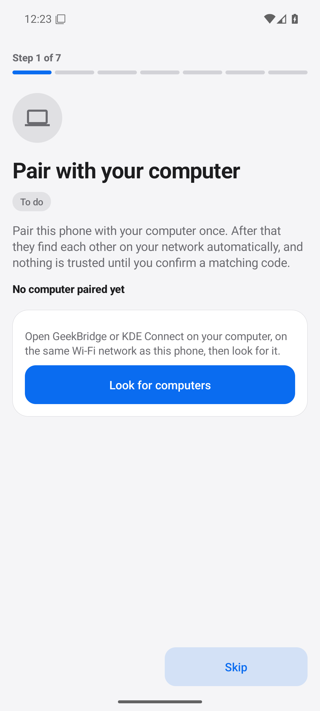
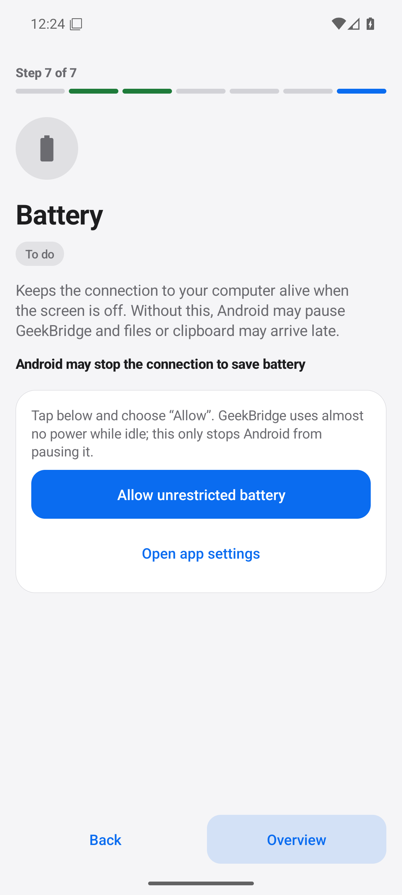
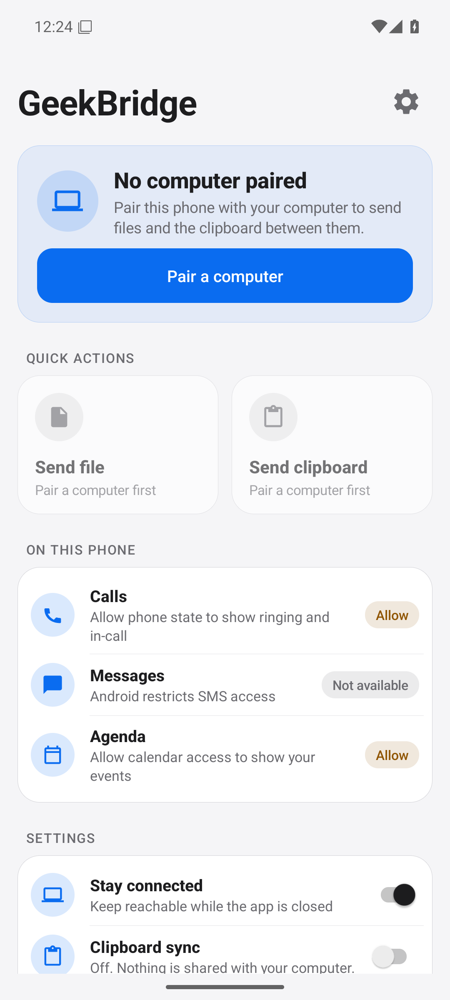
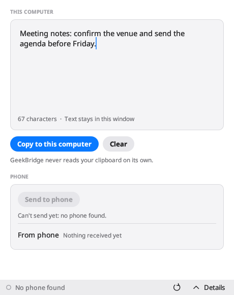
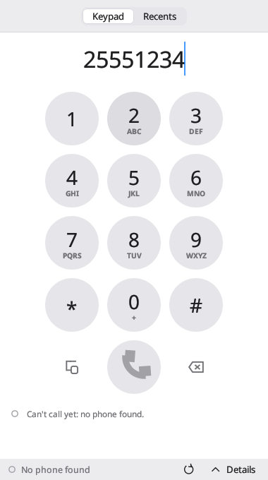
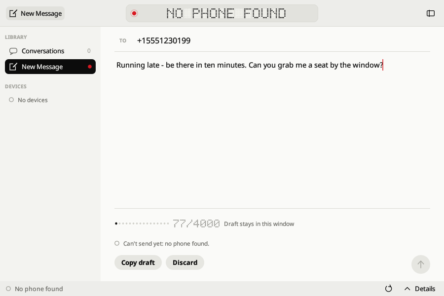

# GeekBridge user guide

GeekBridge links an Android phone with a Linux, Windows or macOS computer over your local network. Calls,
Messages, Agenda, Clipboard and Share are separate desktop apps that talk to one background service
(`geekbridge-service`); the Android companion is the other end. Nothing leaves your network except the optional
update check to GitHub ([updates.md](updates.md)).

> Status: everything below is covered by tests and emulation on Linux. **No real phone, real Bluetooth call or
> stock KDE Connect device has been used yet**, and Windows/macOS binaries have not been run. Expect rough edges.

## 1. Install

| Where | How |
| --- | --- |
| Android | Install `geekbridge-android.apk` from the latest GitHub release (allow "install unknown apps" for your browser/Files once). Release APKs are signed with the project key when the maintainer configured one; otherwise they are debug-signed. |
| Linux | Extract `geekbridge-linux-x86_64.tar.gz` and run `./install.sh` (per-user, into `~/.local`, service starts at login) or `sudo ./install.sh --system`. Release builds also ship a `.deb`. Uninstall with `./install.sh --uninstall`. |
| Windows | Run the Inno Setup installer, or unzip `geekbridge-windows-x86_64.zip`. Binaries are unsigned: SmartScreen will warn. |
| macOS | Open the `.dmg`, or unzip `geekbridge-macos-<arch>.zip`. Binaries are not notarised: use right-click → Open. |
| From source | `cargo build --release` then `cargo run -p bridge-service --bin geekbridge-service`; see [builds.md](builds.md). |

Verify any download against the release's `SHA256SUMS`.

## 2. Pair the phone

1. Put both devices on the same Wi-Fi (no guest/AP-isolation network). Start the service (installed builds do this
   at login) and open any app, for example `geekbridge-calls`.
2. On the phone, open GeekBridge. The setup wizard's first step is **Pair with your computer**; tap
   **Look for computers** and pick yours. The computer's Details panel (bottom right) also lists the phone and has
   **Pair**.
3. Both screens show a verification code. **Compare them**, then confirm on the phone and type/confirm on the
   computer. Discovery alone never grants access; pairing pins each side's certificate.
4. Continue the wizard: notifications, contacts, calendar, phone state, then the **battery** step.

Disconnect or forget a phone from the Details panel or with `geekbridge-ctl disconnect|unpair DEVICE_ID`.
If UDP 1716 is taken by KDE Connect itself, GeekBridge says so instead of taking over.

### Battery step

Android may stop the background connection to save power. The battery step asks for the battery-optimisation
exemption (a real system dialog) and, on Xiaomi, Samsung, Huawei/Honor, OnePlus, OPPO/realme and vivo, lists the
vendor's extra autostart switch. Home shows a warning if the exemption is later revoked. Details:
[android-power.md](android-power.md).

## 3. Quick start

- **Share files, links, text.** Phone: Share → **Send to computer**. Computer: `geekbridge-share` (drop files) or
  `geekbridge-ctl send-file DEVICE_ID PATH`. Receiving on the computer is off per phone until you allow it.
  [sharing.md](sharing.md).
- **Clipboard.** Opt in per phone (off by default). The computer *pulls* the phone's clipboard with the hotkey
  **Ctrl+Shift+V** (changeable; bound system-wide on Hyprland, otherwise bind
  `geekbridge-ctl clipboard paste-from-phone --notify` in your desktop's shortcut settings). Computer → phone
  uses **Send to phone** in the Clipboard app. GeekBridge never reads either clipboard in the background.
  [clipboard-sync.md](clipboard-sync.md).

  
- **Calls.** The Calls app shows an incoming-call popup with **Answer**, **Decline** and later **Hang up** and
  mute, but only offers a button that something can really perform (it needs the phone's Bluetooth calling link).
  CLI: `geekbridge-ctl call answer|reject|hangup`. Only simulated call signalling is verified; no real call or
  audio has been tested. [emulated-calls.md](emulated-calls.md).

  
- **Messages and Agenda.** Local drafts and views only; phone SMS and calendar are not synced yet.

  
- **Updates.** Desktop apps and the Android app show "Update available" with a checksum-verified download; nothing
  installs by itself. Turn it off in Details, in Android settings, or with `geekbridge-ctl update disable`.

## 4. Troubleshooting

- Phone not found: same subnet? Firewall must allow UDP 1716 and TCP 1714-1764. `geekbridge-ctl status` shows
  discovery and links.
- Link drops when the screen is off: finish the wizard's battery step and enable **Stay connected** on Home.
- Hotkey says `unsupported`: your compositor forbids global grabs; bind the command shown in the Clipboard app.
- Diagnostics: Android Home → **Diagnostics & about**; desktop `geekbridge-ctl status`, `scripts/perf-check.sh`.
